<!-- ======================================================== -->
<!-- 🚀 DYNAMIC ANIMATED HEADER HERO                           -->
<!-- ======================================================== -->
<div align="center">


<!-- ANIMATED NAME: SAURABH MISHRA (ORBITRON NEON EFFECT) -->
<a href="https://git.io/typing-svg">
  
</a>

<br/>

<!-- ANIMATED MULTILINE ROLE & SPECIALIZATION STREAM -->
<a href="https://git.io/typing-svg">
  
</a>

<br/><br/>

<!-- Social Badges -->
[](https://www.linkedin.com/in/saurabh-mishradevops-engineer/)
[](https://github.com/saurabh2017sln-oss)
[](mailto:Saurabh2017sln@gmail.com)
[]()

<br/><br/>

[](https://github.com/saurabh2017sln-oss)

<br/><br/>

<!-- ======================================================== -->
<!-- 🌐 PITCH-BLACK SYNAPTIC NEURAL SCENE                     -->
<!-- ======================================================== -->
<a href="https://saurabh2017sln-oss.github.io" target="_blank">
  
</a>

<br/><br/>

<a href="https://saurabh2017sln-oss.github.io" target="_blank">
  
</a>

<p align="center"><sub>💡 <b>Live Neural Engine:</b> Click the glowing button above to launch the full-screen <b>#000000 Jet-Black Canvas</b> where real-time neon light beams follow your mouse cursor, connect to synaptic nodes, and spark on touch/click!</sub></p>


</div>

<!-- ======================================================== -->
<!-- 👤 ABOUT ME WITH ANIMATED DEV ILLUSTRATION               -->
<!-- ======================================================== -->
## 👨‍💻 Executive Summary & About Me

<table>
  <tr>
    <td width="64%" valign="top">

```
+-------------------------------------------------------------------------------------------------+
|  "I architect autonomous, self-healing cloud ecosystems by fusing Agentic AI workflows with     |
|   zero-trust DevSecOps, enterprise landing zones (CAF), and zero-downtime cloud migrations."     |
+-------------------------------------------------------------------------------------------------+
```

I am a **Lead DevSecOps & Agentic AI Cloud Architect** with **5+ years of hands-on experience** spearheading **Microsoft Azure** transformations, **multi-environment Terraform Landing Zones (CAF)**, and **autonomous CI/CD platform engineering**. 

I specialize in **100+ workload enterprise cloud migrations**, shift-left security enforcement (Policy-as-Code, Secret scanning, Container vulnerability management), and **FinOps cloud financial optimization**.

- 🔭 **Current Role:** DevOps Consultant @ **Recruitify Sdn. Bhd. (Malaysia)** — *Remote*
- 🏢 **Previous Experience:** Cloud/DevOps Engineer @ **JM Financial (Dwello)** & **Square Yards**
- 🤖 **Agentic AI Focus:** Autonomous multi-agent CI/CD workflows, LLM-driven infrastructure synthesis, automated drift remediation
- ☁️ **Enterprise Scale:** Cloud Adoption Framework (CAF), Hub-and-Spoke Microsegmentation, DR/BCP, High Availability
- 🛡️ **DevSecOps Paradigm:** Zero-Trust Identity (PIM/RBAC), CIS Azure Benchmarks, Policy-as-Code (OPA/Azure Policy)
- 💰 **FinOps Mastery:** Continuous rightsizing, Reserved Instances (RI/Savings Plans), Waste Elimination, Tagging Governance
- 📫 **Direct Contact:** [Saurabh2017sln@gmail.com](mailto:Saurabh2017sln@gmail.com) | [LinkedIn Profile](https://www.linkedin.com/in/saurabh-mishradevops-engineer/)

    </td>
    <td width="36%" align="center" valign="middle">
      
    </td>
  </tr>
</table>

<div align="center">
  
</div>

<!-- ======================================================== -->
<!-- 🤖 AUTONOMOUS AGENTIC AI & DEVSECOPS ENGINE              -->
<!-- ======================================================== -->
## 🤖 Autonomous Multi-Agent DevSecOps Architecture

> **The Agentic Paradigm:** Transitioning from passive scripts to **autonomous, self-governing multi-agent AI systems** that design, audit, cost-evaluate, and heal cloud infrastructure in real-time.

```mermaid
flowchart LR
    User(["💬 Natural Language / PR Trigger"]) --> Sup["🧠 Supervisor Agent<br/><sub>Orchestrator & State Machine</sub>"]
    Sup --> IaC["🏗️ IaC Agent<br/><sub>Terraform Synthesis</sub>"]
    IaC --> Sec["🛡️ Security Agent<br/><sub>Checkov & OPA Policy</sub>"]
    Sec --> Fin["💰 FinOps Agent<br/><sub>Infracost Budgeting</sub>"]
    Fin --> Drift["🔄 Drift & Test Agent<br/><sub>Terratest & State Lock</sub>"]
    Drift --> Target[("☁️ Azure Enterprise<br/><sub>Landing Zones & AKS</sub>")]
    Target -.->|"Telemetry & Drift Feedback"| Sup

    style User fill:#1e1e2e,stroke:#89b4fa,stroke-width:1.5px,color:#cdd6f4
    style Sup fill:#1e1e2e,stroke:#a6e3a1,stroke-width:2px,color:#cdd6f4
    style IaC fill:#1e1e2e,stroke:#f9e2af,stroke-width:1.5px,color:#cdd6f4
    style Sec fill:#1e1e2e,stroke:#f38ba8,stroke-width:1.5px,color:#cdd6f4
    style Fin fill:#1e1e2e,stroke:#00D084,stroke-width:1.5px,color:#cdd6f4
    style Drift fill:#1e1e2e,stroke:#cba6f7,stroke-width:1.5px,color:#cdd6f4
    style Target fill:#1e1e2e,stroke:#00F0FF,stroke-width:2px,color:#cdd6f4
```

<div align="center">

```bash
saurabh@cloud-mesh:~$ agy agent --autonomous-run --env production
┌────────────────────────────────────────────────────────────────────────────────┐
│ 🤖 AUTONOMOUS MULTI-AGENT DEVSECOPS PIPELINE                                   │
└────────────────────────────────────────────────────────────────────────────────┘
[01:24:02] 🧠 [SUPERVISOR] Decomposed PR #142 -> 3 microservice landing zones
[01:24:08] 🏗️  [IAC AGENT] Synthesized Terraform Azure CAF Landing Zone v2.4
[01:24:14] 🛡️  [SECURITY]   Checkov: 0 High/Critical | CIS Azure Benchmark: 99.1%
[01:24:19] 💰 [FINOPS]     Infracost approved: -$3,400/mo delta (Rightsizing applied)
[01:24:25] 🔄 [DRIFT]      Terratest passed (18 tests) | Remote State Lock Acquired
[01:24:30] 🚀 [DEPLOY]     Zero-downtime cutover successful across 100+ workloads!
```

</div>

| Agent Role | Model / Engine | Primary Mission | Integrated Tooling |
| :--- | :--- | :--- | :--- |
| **🧠 Supervisor Agent** | Azure OpenAI GPT-4o | Task decomposition, state machine orchestration | LangGraph, Semantic Kernel |
| **🏗️ IaC Synthesis Agent** | Claude 3.5 Sonnet | Synthesizes reusable Terraform CAF modules | Terraform 1.5+, HCL, Azure CAF |
| **🛡️ DevSecOps Guard Agent** | DeepSeek-R1 / GPT-4o | Enforces CIS benchmarks, secret scans & OPA rules | Checkov, Tfsec, TruffleHog, Trivy |
| **💰 FinOps Guardian Agent** | Custom FinOps Evaluator | Pre-apply cost anomaly detection & rightsizing | Infracost API, OpenCost, Azure Advisor |
| **🔄 Drift & Healing Agent** | AIOps Event Trigger | Detects out-of-band console drift & self-heals | Terratest, Azure Monitor AMA / DCR |

<div align="center">
  
</div>

<!-- ======================================================== -->
<!-- 🛠️ TECH STACK WITH ANIMATED ICONS                       -->
<!-- ======================================================== -->
## 🛠️ Technology Stack & Architect Toolkit

<div align="center">


<br/>

<div align="center">
  <a href="https://saurabh2017sln-oss.github.io/">
    
  </a>
  <br/>
  <sub>⚡ <b>Live 3D Physics Dock & Neural Canvas:</b> Experience real-time mouse-hover popup lift (translateY) & synaptic touch bursts on the live web application!</sub>
</div>

<br/>

<!-- ======================================================== -->
<!-- 🛠️ INTERACTIVE POPUP TOOLSETS (CATEGORIZED ACCORDIONS)    -->
<!-- ======================================================== -->

<details open>
<summary><b>☁️ Set 1: Multi-Cloud Platforms & Landing Zones (Click to expand / collapse)</b></summary>
<br/>
<div align="center">
  <a href="https://azure.microsoft.com" title="Microsoft Azure | Enterprise Architecture & Landing Zones"></a>
  <a href="https://aws.amazon.com" title="Amazon Web Services | Multi-Cloud Infrastructure"></a>
  <a href="https://cloud.google.com" title="Google Cloud Platform | Hybrid Deployments"></a>
  <a href="https://cloudflare.com" title="Cloudflare | Edge Security, WAF & Zero Trust"></a>
</div>
</details>

<br/>

<details open>
<summary><b>🏗️ Set 2: Infrastructure as Code (IaC) & Container Orchestration</b></summary>
<br/>
<div align="center">
  <a href="https://terraform.io" title="Terraform | Reusable CAF Landing Zone Modules"></a>
  <a href="https://ansible.com" title="Ansible | Automated Configuration & Bastion Bootstrapping"></a>
  <a href="https://kubernetes.io" title="Kubernetes | Production Orchestration & Self-Healing"></a>
  <a href="https://docker.com" title="Docker | Immutable Containerization"></a>
  <a href="https://nginx.org" title="Nginx | Ingress & Reverse Proxy Routing"></a>
</div>
</details>

<br/>

<details open>
<summary><b>🔁 Set 3: Enterprise CI/CD, GitOps & Version Control</b></summary>
<br/>
<div align="center">
  <a href="https://github.com/features/actions" title="GitHub Actions | Automated Multi-Stage Pipelines"></a>
  <a href="https://jenkins.io" title="Jenkins | Legacy & Enterprise Orchestration"></a>
  <a href="https://gitlab.com" title="GitLab CI/CD | Secure Pipeline Runner"></a>
  <a href="https://git-scm.com" title="Git | Trunk-Based Branching & Governance"></a>
  <a href="https://github.com" title="GitHub | Code Reviews & CODEOWNERS Enforcement"></a>
</div>
</details>

<br/>

<details open>
<summary><b>🤖 Set 4: Agentic AI, GenAI & Autonomous Workflows</b></summary>
<br/>
<div align="center">
  <a href="https://python.org" title="Python | AI Agents, Fast Automation & Scripting"></a>
  <a href="https://fastapi.tiangolo.com" title="FastAPI | High-Performance AI Microservices & APIs"></a>
  <a href="https://pytorch.org" title="PyTorch | Machine Learning & Deep Learning Models"></a>
  <br/><br/>
  <!-- AI Agent Badges -->
  
  
  
  
  
</div>
</details>

<br/>

<details open>
<summary><b>🔐 Set 5: DevSecOps, Shift-Left & Security Gatekeepers</b></summary>
<br/>
<div align="center">
  
  
  
  
  
  
</div>
</details>

<br/>

<details open>
<summary><b>📊 Set 6: Observability, FinOps & Cloud Telemetry</b></summary>
<br/>
<div align="center">
  <a href="https://prometheus.io" title="Prometheus | Time-Series Metrics Collection"></a>
  <a href="https://grafana.com" title="Grafana | Real-Time Telemetry Dashboards"></a>
  <br/><br/>
  
  
  
</div>
</details>

<br/>

<details open>
<summary><b>💻 Set 7: OS, Automation Scripting & Distributed Data Stores</b></summary>
<br/>
<div align="center">
  <a href="https://kernel.org" title="Linux | Enterprise Server Baselines & Hardening"></a>
  <a href="https://ubuntu.com" title="Ubuntu | Cloud Compute VMs & Runners"></a>
  <a href="https://microsoft.com/windows" title="Windows | Enterprise Systems"></a>
  <a href="https://gnu.org/software/bash" title="Bash | Shell Automation & Cloud-Init"></a>
  <a href="https://microsoft.com/powershell" title="PowerShell | Azure Automation & Admin"></a>
  <a href="https://postgresql.org" title="PostgreSQL | ACID Relational Database"></a>
  <a href="https://redis.io" title="Redis | In-Memory Distributed Caching & Broker"></a>
  <a href="https://code.visualstudio.com" title="VS Code | Primary Development & Architecture Environment"></a>
</div>
</details>

<br/>


</div>

<!-- ======================================================== -->
<!-- 💼 CAREER TIMELINE                                       -->
<!-- ======================================================== -->
## 💼 Experience & Leadership Journey

```text
2025 - Present   🚀 DevOps Consultant @ Recruitify Sdn. Bhd. (Malaysia) — Remote
2023 - 2025      ⚡ Cloud/DevOps Engineer @ JM Financial (Dwello), Mumbai
2022 - 2023      🛠️ DevOps Engineer @ Square Yards, Mumbai
```

> **Core Impact Highlights:**
> - 🏛️ Built enterprise-grade **reusable Terraform parent/child modules** powering consistent zero-drift infrastructure across Dev, UAT, and Production.
> - 🛡️ Implemented automated **DevSecOps gatekeepers** (Tfsec, TFLint, TruffleHog, Terratest, Trivy) cutting security vulnerabilities by over 70% before runtime.
> - 🌐 Engineered **Azure Application Gateway & Front Door WAF** topologies with end-to-end SSL termination, path-based routing, and health probes.
> - 💰 Spearheaded **FinOps cloud governance & OpenCost integration**, identifying orphan resources, unattached managed disks, and implementing automated scheduling to optimize cloud spend.

<div align="center">
  
</div>

<!-- ======================================================== -->
<!-- 🎯 MASTER ARCHITECT PLAYBOOK & INTERVIEW PREP GUIDE      -->
<!-- ======================================================== -->
<div align="center">

# 🎯 Enterprise Cloud Architect & Senior DevOps Blueprint


<br/>

> **Reference File:** `diagram.pdf` | **Architecture Scope:** 100+ Enterprise Workload Migration, Landing Zones (CAF), Multi-Tier Hub-and-Spoke, Zero-Trust DevSecOps, FinOps, High Availability & Governance.

</div>

<details open>
<summary><b>📑 Click to Expand Quick Navigation (Table of Contents)</b></summary>

| Module | Architectural Domain | Key Focus Areas |
| :---: | :--- | :--- |
| **[01](#1-professional-portfolio--standing-out-how-to-look-unique)** | **Portfolio & Executive Brand** | Strategic Impact, ROI, Resume, Technical Blog, ADRs |
| **[02](#2-it-career-tracks--roles-matrix)** | **Career Tracks & Roles Matrix** | Sales, Pre-Sales, TAM, Enterprise Architect, Tech Lead |
| **[03](#3-the-senior-mindset-business--architecture-alignment)** | **Business & Architecture Alignment** | Functional Domain, Infra vs App Design, Pre-Sales, SOPs |
| **[04](#4-real-world-architecture-scenario-100-application-migration)** | **100+ Workload Migration Scenario** | 10 Scalability & Quality Pillars, On-Prem to Azure |
| **[05](#5-enterprise-governance-identity--management-hierarchy)** | **Governance & Management Hierarchy** | Microsoft CAF, Entra ID, Management Groups, PIM, Policies |
| **[06](#6-enterprise-hub-and-spoke-networking-architecture)** | **Hub-and-Spoke Network Topology** | ExpressRoute/VPN, Azure Firewall, UDRs, Private Endpoints |
| **[07](#7-multi-layered-defense-in-depth-security)** | **Defense-in-Depth Security Matrix** | Identity, Network, Governance, Compute Security Layers |
| **[08](#8-terraform-landing-zone-automation--best-practices)** | **Terraform Landing Zones & IaC** | Modular IaC, Infracost, Checkov, Remote State Locking, Drift |
| **[09](#9-azure-repos--devsecops-pipelines)** | **CI/CD & DevSecOps Pipelines** | Trunk-Based Branching, CODEOWNERS, 6-Stage Gatekeeper |
| **[10](#10-end-to-end-cloud-migration-strategy)** | **End-to-End Migration Lifecycle** | Discovery, Assessment, Readiness, Cutover, 24x7 War Room |
| **[11](#11-finops-cloud-financial-management)** | **FinOps (Cloud Cost Management)** | Waste Elimination, Rightsizing, RIs, Savings Plans, DCR |
| **[12](#12-backup-disaster-recovery--high-availability)** | **Backup, DR & High Availability** | LRS/ZRS/GRS, VMSS Multi-AZ, RTO/RPO Metrics, Azure Site Recovery |
| **[13](#13-enterprise-observability--monitoring)** | **Observability & Telemetry** | Azure Monitor Agent (AMA), Data Collection Rules, Action Groups |
| **[14](#14-vendor-management--delivery-governance)** | **Vendor & Delivery Governance** | RFI/RFP, Technical Evaluation, SOW, RACI Matrix, KT Handover |

</details>

---

### 1. Professional Portfolio & Standing Out ("How to Look Unique?")

In senior and lead-level evaluations, top architects stand out not through raw tool syntax, but through **strategic business acumen**, **system design maturity**, and **leadership**.

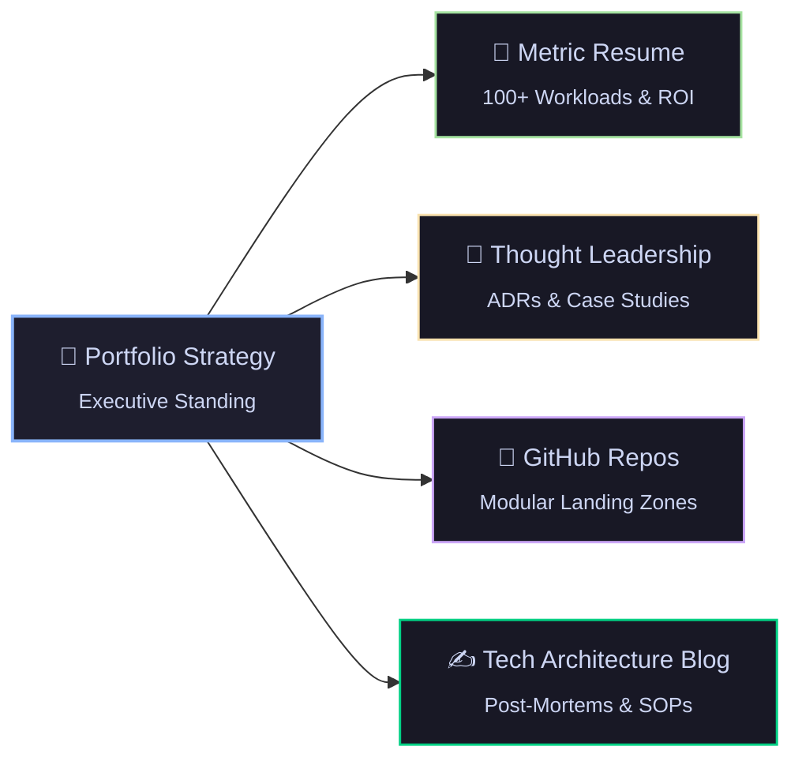

#### Essential Portfolio Assets
- 📄 **Resume:** Focus on business impact, ROI, and scale (*e.g., "Architected the migration of 100+ enterprise workloads with zero downtime and slashed monthly cloud spend by 28%"*).
- 💼 **LinkedIn Profile:** Active thought leadership, detailed architecture blueprints, post-mortems, and stakeholder testimonials.
- 🐙 **GitHub Repository:** Production-ready Terraform Landing Zone modules, reusable GitHub Actions / Azure DevOps templates, and documented ADRs.
- ✍️ **Technical Blog / Website:** Real-world case studies, migration retrospectives, and Architectural Decision Records (ADRs).

---

### 2. IT Career Tracks & Roles Matrix

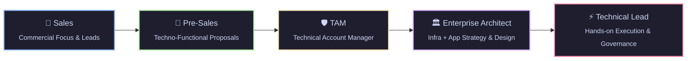

- **Sales:** Commercial focus, lead generation, client executive relationships, contract values.
- **Pre-Sales (Techno-Functional):** RFPs/RFIs, POC execution, solution sizing, technical demonstrations, commercial bid models.
- **TAM (Technical Account Manager):** Trusted technical advisor, governance, operational escalations, account stability.
- **Enterprise Architect:** Holistic technology blueprint spanning infrastructure, security, data, and application ecosystems.
- **Technical Lead:** Hands-on sprint execution, code/IaC reviews, architectural enforcement, mentoring.

---

### 3. The Senior Mindset: Business & Architecture Alignment

A senior candidate must answer first: **"What is the business? What is the functional domain?"**

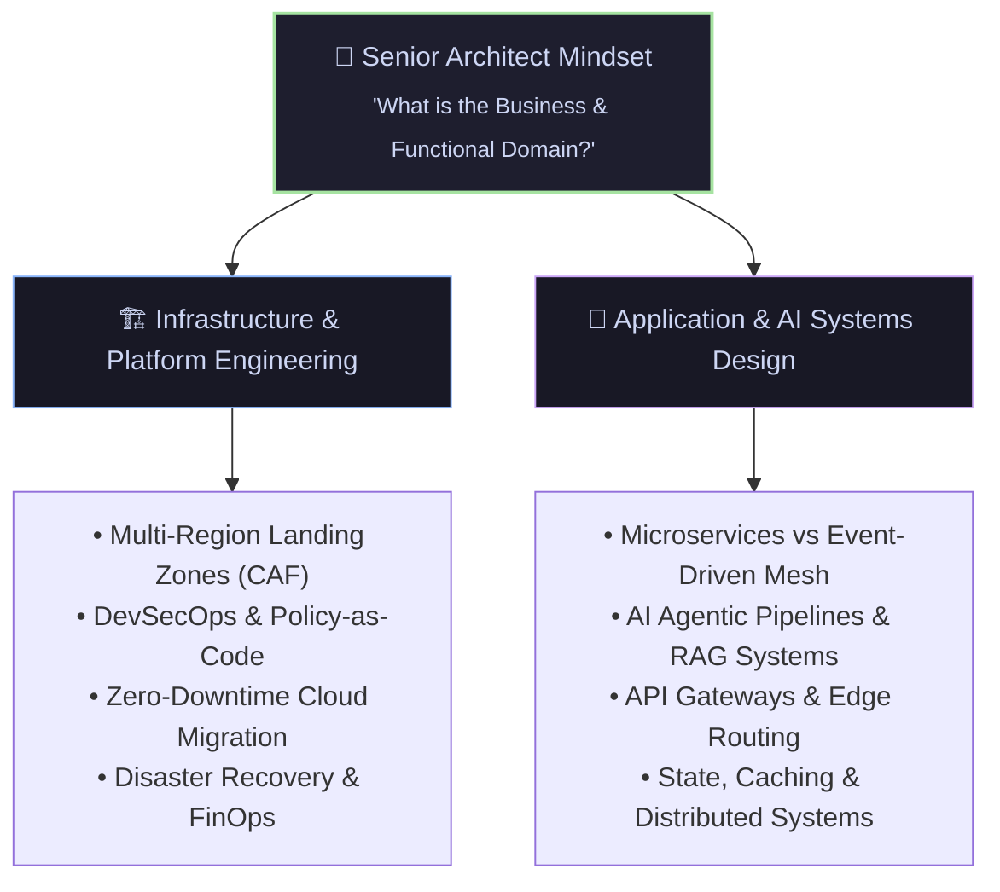

#### Executive & Leadership Responsibilities
- 🎓 **Leadership & Team Upskilling:** Leading technical KT sessions, running workshops, building hiring rubrics.
- 🤝 **Vendor & Service Management:** SOW negotiations, milestone sign-offs, SLA and RACI tracking.
- 📑 **Pre-Sales & Proposals:** Technical estimations, architecture pitch decks, RFP/RFI responses.
- 🛡️ **Delivery Governance:** Authoring standard operating procedures (SOPs), post-incident retrospectives, architectural conformance reviews.

---

### 4. Real-World Architecture Scenario: 100+ Application Migration

> [!IMPORTANT]
> **Problem Statement:** Migrating 100+ enterprise workloads across Dev, UAT, and Production from an On-Premises Datacenter to Microsoft Azure with zero downtime and strict compliance.

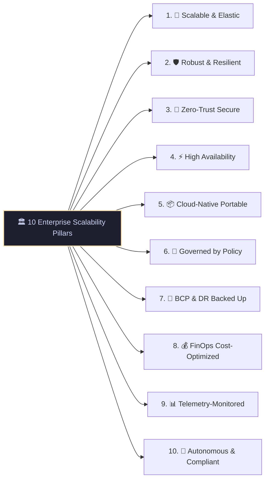

---

### 5. Enterprise Governance, Identity & Management Hierarchy

#### Cloud Adoption Framework (CAF) Methodology
Microsoft CAF guides end-to-end cloud adoption across six iterative phases:
1. **Strategy:** Define business justification, motivations, and expected ROI.
2. **Plan:** Inventory workloads, assess organizational readiness, and plan landing zones.
3. **Ready:** Prepare the cloud environment, management groups, and core identity foundations.
4. **Adopt:** Migrate and modernize workloads in agile sprint cycles.
5. **Govern:** Enforce Azure Policies, cost guardrails, and compliance benchmarks.
6. **Secure & Manage:** Continuous monitoring, threat detection, and automated patching.

#### Tenant & Management Group Hierarchy

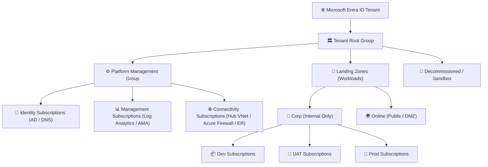

#### Best Practices:
- **Subscription Boundaries:** Segregate subscriptions strictly by environment (`Dev`, `UAT`, `Prod`) and function (`Platform` vs `Application`) to prevent noisy neighbor problems and isolate the blast radius.
- **Azure Policy & Initiatives:** Assign built-in initiatives (e.g., CIS Azure Benchmark, MCSB) at the Management Group level; enforce audit/deny effects with time-bound, documented policy exemptions.
- **RBAC & PIM:** Group-based RBAC with Microsoft Entra ID; mandate Privileged Identity Management (PIM) with just-in-time access, MFA, and multi-stage managerial approvals.

---

### 6. Enterprise Hub-and-Spoke Networking Architecture

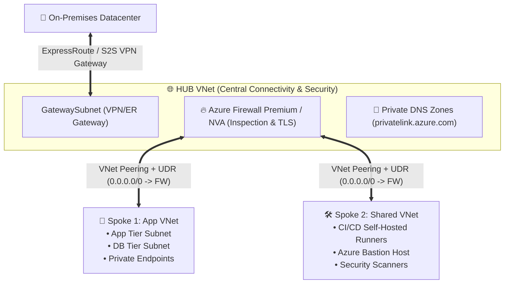

#### Key Networking Elements:
- **IP Address Management (IPAM) & CIDR:** Comprehensive discovery and auditing of on-prem CIDRs to prevent overlapping IP address spaces with Azure VNets.
- **Centralized Traffic Inspection:** User Defined Routes (UDRs) forcing `0.0.0.0/0` and inter-spoke traffic through the Azure Firewall / Network Virtual Appliance (NVA).
- **Controlled Egress & Ingress:** Centralized Internet egress through firewall with TLS inspection; inbound traffic filtered via Azure Application Gateway / Front Door with Web Application Firewall (WAF).
- **Private Connectivity:** Private Endpoints for all PaaS services (Key Vault, Storage, SQL) with central Private DNS Zone resolution linked back to the Hub VNet.

---

### 7. Multi-Layered Defense-in-Depth Security

| Layer | Key Controls & Technologies |
| :--- | :--- |
| **🔑 Identity Level** | Microsoft Entra ID, Conditional Access Policies, Multi-Factor Authentication (MFA), Privileged Identity Management (PIM), Managed Identities (System/User-Assigned). |
| **🌐 Networking Level** | Hub-and-Spoke, Micro-segmentation via NSGs/ASGs, Azure Firewall Premium (IDPS/TLS Inspection), Private Endpoints, DDoS Protection Standard. |
| **📜 Governance Level** | Azure Policy enforcement, CIS Azure / ISO27001 / PCI-DSS compliance initiatives, Microsoft Defender for Cloud Secure Score tracking. |
| **💻 Compute Level** | Defender for Servers, automated vulnerability scanning (Trivy), Disk Encryption with Customer Managed Keys (CMK), automated OS patch management baselines. |

---

### 8. Terraform Landing Zone Automation & Best Practices

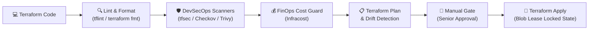

- **Remote State Management:** Remote state stored in private, geo-redundant Azure Storage Account with blob lease locking, encrypted with customer-managed keys, and accessed via Least Privilege Managed Identities.
- **Modularity:** Reusable, parameterized Terraform modules with strict semantic versioning (`v1.2.0`) and modular directory separation (networking, compute, identity).
- **Automated Drift Detection:** Scheduled nightly cron pipelines running `terraform plan -detailed-exitcode` to immediately flag any manual out-of-band portal changes.

---

### 9. Azure Repos & DevSecOps Pipelines

- **Branching Strategy:** Trunk-based development with short-lived feature branches (`feature/*`, `fix/*`).
- **Branch Policies:**
  - Strict branch protection on `main`.
  - Mandatory Pull Request (PR) with a minimum of 2 senior reviewers.
  - Code owners (`CODEOWNERS`) file enforcement for security and infrastructure paths.
  - "No Delete" and "No Direct Push" on production branches.
- **YAML Pipeline Template Flow:**
  1. **Validate & Test:** `terraform validate`, `tflint`, unit testing.
  2. **Security & Secrets:** GitLeaks, Checkov, Trivy vulnerability scans.
  3. **Build & Plan:** Generate and publish plan artifacts.
  4. **Approval Gate:** Manual sign-off gate for UAT and Production.
  5. **Deploy & Apply:** Execute deployment with managed identities.
  6. **Automated Rollback:** Automated failure rollback plan and notification dispatch.
- **Custom Middleware Setup:** VM custom data / Cloud-Init scripts for baseline configuration and monitoring agent bootstrapping.

---

### 10. End-to-End Cloud Migration Strategy

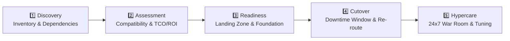

#### Migration Checklists:
- **Pre-Migration:** Discovery reports (Azure Migrate), dependency mapping, bandwidth sizing, target Landing Zone verification, full backup verification.
- **During-Migration (Cutover):** Traffic rerouting, database replication final sync, DNS TTL reduction, validation and smoke testing.
- **Post-Migration & Hypercare:** Health telemetry checks, end-user sanity testing, performance benchmarking, 2–4 weeks dedicated war room support.

---

### 11. FinOps (Cloud Financial Management)

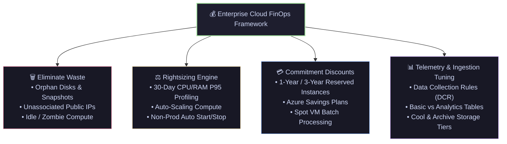

- **Eliminate Waste:** Detect and remove unattached managed disks, obsolete snapshots, unassociated public IPs, and idle compute instances.
- **Rightsizing:** Resize oversized VMs based on 30-day CPU/Memory utilization percentiles.
- **Commitment Discounts:** Reserved Instances (1-year or 3-year RI) and Azure Savings Plans for steady-state workloads.
- **Automated Scheduling:** Automated start/stop for non-production environments outside business hours.
- **Log Ingestion Tuning:** Review Azure Monitor log ingestion tables; configure Data Collection Rules (DCR) to filter noisy diagnostic logs.

---

### 12. Backup, Disaster Recovery & High Availability

- **Storage Redundancy:**
  - **LRS (Locally Redundant Storage):** 3 copies within a single datacenter.
  - **ZRS (Zone-Redundant Storage):** 3 copies across 3 availability zones in a single region.
  - **GRS (Geo-Redundant Storage):** Replicated to a secondary paired region for disaster recovery.
- **High Availability Compute:** Virtual Machine Scale Sets (VMSS) spread across multiple Availability Zones.
- **RTO & RPO Definitions:**
  - **RTO (Recovery Time Objective):** Maximum acceptable duration of downtime before the system is restored.
  - **RPO (Recovery Point Objective):** Maximum acceptable data loss measured in time (*e.g., maximum 15 minutes of transactional data*).
- **Region Strategy:** Primary active region with Azure Site Recovery (ASR) continuously replicating to secondary paired region.

---

### 13. Enterprise Observability & Monitoring

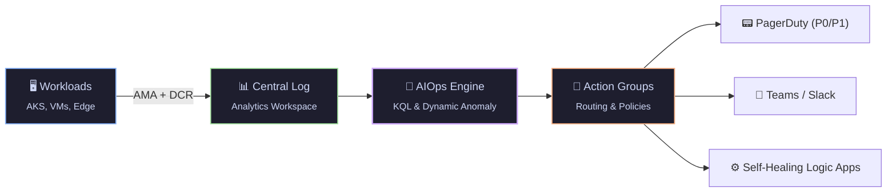

- **Azure Monitor & Log Analytics:** Centralized Log Analytics Workspace per enterprise landing zone.
- **Azure Monitor Agent (AMA):** Ingestion filtered at source via Data Collection Rules (DCR) to optimize cost and performance.
- **Alerting & Escalation:** Action Groups routing alerts dynamically to Microsoft Teams channels, Slack, or PagerDuty for critical incidents.

---

### 14. Vendor Management & Delivery Governance

Senior engineers and architects regularly evaluate, negotiate with, and govern external partners and vendors.

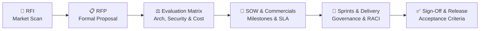

#### Critical Governance Concepts:
- **SOW (Statement of Work):** Formal document detailing scope, deliverables, acceptance criteria, timeline, milestones, and liabilities.
- **Technical Evaluation Matrix:** Scoring vendors objectively against architecture capabilities, security compliance, past experience, and pricing.
- **RACI Matrix:**
  - **R**esponsible: Who executes the task.
  - **A**ccountable: The single individual answerable for deliverable completion.
  - **C**onsulted: Subject matter experts providing input.
  - **I**nformed: Stakeholders kept updated on progress.
- **Escalation Matrix:** Clearly defined escalation paths and SLAs when technical blockers or contract breaches occur.
- **Transition & Knowledge Transfer:** Formal documentation handover, runbooks, architecture walk-throughs, and shadowing before sign-off.

<div align="center">
  
</div>

<!-- ======================================================== -->
<!-- 📌 FEATURED PROJECTS                                     -->
<!-- ======================================================== -->
## 📌 Featured Production Architecture

<div align="center">

[](https://github.com/saurabh2017sln-oss/Production-environment)

</div>

**🏗️ [Production-environment](https://github.com/saurabh2017sln-oss/Production-environment)** — Enterprise-grade cloud infrastructure automation using Terraform. Implements Azure deployment best practices with reusable parent and child modules, hub-and-spoke networking, automated security linting, and drift detection.


<div align="center">
  
</div>

<!-- ======================================================== -->
<!-- 📈 GITHUB METRICS & TELEMETRY                           -->
<!-- ======================================================== -->
## 📈 Engineering Telemetry & Activity

<div align="center">


<br/><br/>


<br/><br/>


<br/><br/>

<!-- Agentic AI & Cloud Ops Status Dashboard Badges -->
<div align="center">
  
  
  
  
</div>

</div>

<div align="center">
  
</div>

<!-- ======================================================== -->
<!-- 🎓 EDUCATION                                             -->
<!-- ======================================================== -->
## 🎓 Education & Certifications

- 🎓 **Bachelor's Degree** — *Graduated 2022*
- 🏫 **Intermediate / Class XII** (U.P Board) — *2019*
- 🏫 **High School / Class X** (C.B.S.E.) — *2017*

<div align="center">
  
</div>

<!-- ======================================================== -->
<!-- 📫 LET'S CONNECT & FOOTER BANNER                         -->
<!-- ======================================================== -->
## 🤝 Let's Connect & Collaborate

<div align="center">


<br/>

```
"Open to discussing Enterprise Cloud Architecture, Autonomous Agentic AI, and DevSecOps Platforms."
```

<br/>

[](https://www.linkedin.com/in/saurabh-mishradevops-engineer/)
[](https://github.com/saurabh2017sln-oss)
[](mailto:Saurabh2017sln@gmail.com)

<br/><br/>

⭐ *Always pushing the boundaries of Cloud Native engineering, Agentic AI, and Autonomous Platform Engineering.*

<br/>


</div>
